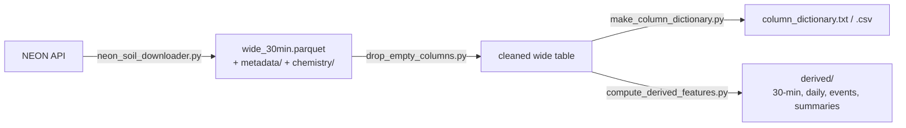

# NEON Soil & Weather Time-Series Pipeline

Download, clean, document and feature-engineer multi-year soil and weather sensor data from the
[US National Ecological Observatory Network (NEON)](https://www.neonscience.org/), ready for
time-series machine learning.

Built to support sensor-based **soil-health classification**: NEON data is used for pipeline testing,
pretraining and weather/soil context. Labels come from your own sensors.


**Docs:** [Handover notes](docs/HANDOVER.md) · [Dataset description and feature formulas](docs/DATASET.md) ([PDF](docs/NEON_SRER_Soil_Weather_Dataset.pdf))

---

## Contents

- [Features](#features)
- [Pipeline](#pipeline)
- [Quick start](#quick-start)
- [Scripts](#scripts)
- [Outputs](#outputs)
- [Column naming](#column-naming)
- [Derived features](#derived-features)
- [Known limitations](#known-limitations)
- [Data source and citation](#data-source-and-citation)

---

## Features

- **12 continuous NEON products** at 30-min resolution: soil temperature, soil water content and salinity, soil CO₂, soil heat flux, IR surface temperature, air temperature, humidity, precipitation, radiation, PAR, wind, and pressure. Periodic soil lab chemistry (pH, C, N) is also downloaded.
- **Full record in one setting:** `START = END = "auto"` downloads every available month per product, one year at a time, so memory use stays low.
- **Quality-controlled:** values with a NEON final quality flag of 1 are masked to NaN.
- **ML-ready wide table:** each plot × depth sensor becomes one column, merged on a regular 30-min UTC grid.
- **Self-documenting:** a generated data dictionary gives the description, units, real depth in m, and coverage for every column.
- **About 300 derived features:** VPD, net radiation, FAO-56 ET₀, soil water storage, thermal diffusivity, CO₂ efflux, Q10, rain-event responses, rolling statistics, slopes, lags, and anomalies.
- **No terminal needed:** every script has a CONFIG block. Edit it and press Run in VS Code, PyCharm, Spyder or Jupyter.

## Pipeline



| Step | Script | What it does |
| ---- | ------ | ------------ |
| 1 | `neon_soil_downloader.py` | Download, QC-mask, pivot and merge all products |
| 2 | `drop_empty_columns.py` | Remove columns with no data; keep parquet in sync |
| 3 | `make_column_dictionary.py` | Write a readable dictionary of every column |
| 4 | `compute_derived_features.py` | Compute physics-based and time-series features |

## Quick start

### 1. Install

```bash
pip install -r requirements.txt
```

### 2. Get a NEON API token

NEON has required a token for data downloads since June 2026.
Sign in at [neonscience.org](https://www.neonscience.org/) → **My Account** → generate an API token.

> [!WARNING]
> The token is personal. Never commit it. Either leave `NEON_TOKEN = ""` in the script and use an
> environment variable, or make sure the script with your token pasted in is not pushed:
>
> ```bash
> setx NEON_TOKEN "your-token"     # Windows, then open a new terminal
> export NEON_TOKEN="your-token"   # Linux / macOS
> ```

### 3. Download (start small)

Edit the CONFIG block at the top of `neon_soil_downloader.py`:

```python
NEON_TOKEN = ""          # or paste here (do not commit)
SITE       = "SRER"      # Santa Rita Experimental Range, AZ (semi-arid)
START      = "2022-01"   # test range first; "auto" = earliest available
END        = "2022-03"   # "auto" = latest available
```

Press **Run**, or use the command line (flags override the CONFIG block):

```bash
python neon_soil_downloader.py --site SRER --start auto --end auto --token YOUR_TOKEN
```

Check `neon_data/SRER/download_report.csv` for skipped or failed products.

### 4. Clean, document, derive

```bash
python drop_empty_columns.py
python make_column_dictionary.py
python compute_derived_features.py
```

> [!TIP]
> Relative paths resolve against your IDE's working directory. If outputs land in an unexpected
> place, set the same absolute path in all four scripts, e.g. `r"C:\data\neon_data"`.

## Scripts

### `neon_soil_downloader.py`

| Setting | Default | Meaning |
| ------- | ------- | ------- |
| `NEON_TOKEN` | `""` | API token (falls back to `--token`, then the `NEON_TOKEN` env var) |
| `SITE` | `"SRER"` | 4-letter NEON site code |
| `START` / `END` | `"auto"` | `YYYY-MM`, or `"auto"` for each product's full record |
| `OUT_DIR` | `"neon_data"` | Output root |
| `PROVISIONAL` | `False` | Include newest, not-yet-released months |
| `KEEP_FLAGGED` | `False` | Keep values that failed NEON quality checks |
| `SKIP_CHEMISTRY` | `False` | Skip periodic soil lab data |

Products downloaded:

| Short name | NEON ID | Short name | NEON ID |
| ---------- | ------- | ---------- | ------- |
| `soil_temp` | DP1.00041.001 | `air_temp` | DP1.00003.001 |
| `soil_water` | DP1.00094.001 | `rel_humidity` | DP1.00098.001 |
| `soil_co2` | DP1.00095.001 | `precip` | DP1.00006.001 |
| `soil_heatflux` | DP1.00040.001 | `radiation` | DP1.00023.001 |
| `ir_surf_temp` | DP1.00005.001 | `par` | DP1.00024.001 |
| `wind` | DP1.00001.001 | `pressure` | DP1.00004.001 |
| `soil_chem_periodic` | DP1.10086.001 | | |

### `drop_empty_columns.py`

| Setting | Default | Meaning |
| ------- | ------- | ------- |
| `DATA_DIR` | `"neon_data"` | Folder scanned recursively for CSVs |
| `MIN_COVERAGE` | `0.0` | `0` drops only fully empty columns; `0.05` also drops columns with <5% data |
| `IN_PLACE` | `True` | `False` writes `*_clean.csv` copies (dry run) |
| `UPDATE_PARQUET` | `True` | Apply the same drops to `wide_30min.parquet` |

Reads in 50k-row chunks, so multi-GB files are fine. Writes `dropped_columns_log.csv`.

### `make_column_dictionary.py`

Set `SITE_DIR` and `DATA_FILE`. Produces `column_dictionary.txt` (readable, grouped by product) and
`column_dictionary.csv` (filterable, e.g. `coverage_pct > 80`).

### `compute_derived_features.py`

| Setting | Default | Meaning |
| ------- | ------- | ------- |
| `SITE_DIR` | `"neon_data/SRER"` | Folder with `wide_30min.parquet` and `metadata/` |
| `SITE_LAT`, `SITE_LON`, `SITE_ELEV_M` | SRER approx. | Used only if metadata lacks reference coordinates |
| `BULK_DENSITY_G_CM3` | `1.5` | Sets porosity for CO₂ flux |
| `FIELD_CAPACITY`, `WILTING_POINT` | `None` | Set both to enable plant-available water |
| `GDD_BASE_C` | `10.0` | Growing-degree-day base temperature |
| `RAIN_*` | 0.2 mm / 2 mm / 6 h | Rain step, event minimum, event gap |
| `TS_FEATURES` | 9 features | Columns that get rolling/slope/lag/anomaly features (~20 each) |

Each feature group runs independently. A missing product skips only the features that depend on it
and logs `[fail] <group>: <reason>`.

## Outputs

```
neon_data/
├── dropped_columns_log.csv
└── SRER/
    ├── wide_30min.parquet            # main table (use this; the .csv is several GB)
    ├── wide_30min.csv
    ├── download_report.csv           # ok / skipped / failed per product
    ├── column_dictionary.txt | .csv  # description, units, plot, depth, coverage
    ├── per_product/*.csv             # one wide table per product
    ├── metadata/                     # sensor_positions (depths), variables (units), issueLog
    ├── chemistry/*.csv               # periodic pH, moisture, C, N
    └── derived/
        ├── derived_30min.parquet
        ├── derived_daily.parquet
        ├── events.csv                # per rain event: wetting lag, drydown tau, CO2 pulse
        ├── summary_q10.csv
        ├── summary_co2_by_moisture_temp.csv
        ├── summary_xcorr_lags.csv
        └── feature_dictionary.csv    # name, group, description, units
```

```python
import pandas as pd
df = pd.read_parquet("neon_data/SRER/wide_30min.parquet")             # raw channels
fx = pd.read_parquet("neon_data/SRER/derived/derived_30min.parquet")  # derived features
```

## Column naming

```
<product>_<NEONtable>__<variable>__h<plot>_v<depth index>
```

Example: `soil_temp_ST_30_minute__soilTempMean__h001_v502` is soil temperature, plot 1, depth
index 502. The real depth in metres is in `column_dictionary.txt`. Weather columns have no plot/depth
suffix. All timestamps are **UTC**.

## Derived features

| Group | Examples |
| ----- | -------- |
| Atmosphere | saturation/actual vapour pressure, VPD, specific humidity, dew-point depression, GDD |
| Radiation & energy | net SW/LW, net radiation, albedo, radiometric surface temp, G/Rn, solar elevation, clearness index |
| Evapotranspiration | wind at 2 m, ASCE/FAO-56 hourly ET₀, Priestley–Taylor ET |
| Soil water | profile storage, ΔS, water-balance residual, relative wetness, API, days since rain, salinity proxy |
| Rain events | wetting-front arrival lag per depth, drydown time constant τ, CO₂ pulse |
| Soil heat | vertical gradients, diurnal range, phase lag, thermal diffusivity κ |
| Soil CO₂ | gradients, flux-gradient efflux (Millington–Quirk), Q10, CO₂ × moisture × temperature bins |
| Time series | wind u/v, cyclic time, cross-plot mean/std, rolling stats, slopes, diffs, lags, climatology z-scores |

Verified on synthetic NEON-format data with known answers: Q10, thermal diffusivity, drydown τ,
soil-temperature lag, albedo and solar noon were all recovered.

## Known limitations

- `compute_derived_features.py` has been tested on synthetic data only, not yet on a full real download. Check the log for `[fail]` lines.
- NEON has no soil-health or disease labels. Use it for forecasting, anomaly detection, pretraining and pipeline testing.
- Products start on different dates and have gaps. Trim to a window where your chosen channels overlap.
- Sensor positions are the latest per product-year; earlier reinstallations at other depths may not appear in the dictionary.
- `VSICMean` is an ion-content index, not calibrated EC in dS/m.
- Data downloaded before the `StdErMean` fix still contains standard-error columns. Remove them with:

  ```python
  import pandas as pd
  p = "neon_data/SRER/wide_30min.parquet"
  df = pd.read_parquet(p)
  df.loc[:, ~df.columns.str.contains("StdErMean")].to_parquet(p)
  ```

## Data source and citation

Data: National Ecological Observatory Network (NEON), operated by Battelle and funded by the U.S.
National Science Foundation. Cite the specific data products and release you use, following
[NEON's citation guidelines](https://www.neonscience.org/data-samples/guidelines-policies/citing).

Code dependencies: [`neonutilities`](https://github.com/NEONScience/NEON-utilities-python),
pandas, numpy, pyarrow, requests.
